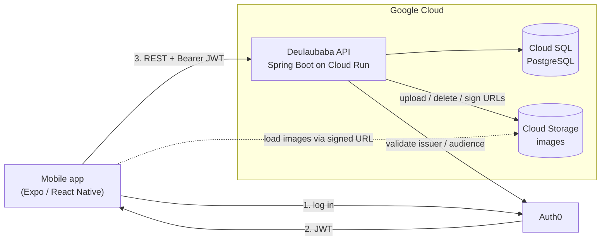
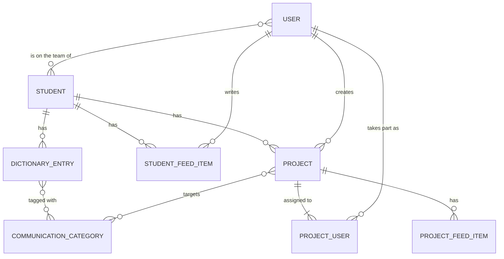

# Deulaubaba — Server

A REST API for **Deulaubaba (들어바바)**, a mobile app built for a special-education research project at Ewha Womans University. The app helps the people around a student with communication difficulties (teachers, parents and therapists) build up a shared picture of how that child communicates, and work together on goals for them.

This repository is the backend: a Spring Boot service that handles accounts, students, a shared "communication dictionary", a daily feed and collaborative projects, with images stored in Google Cloud Storage.

> **Status:** built for a funded research project and deployed on Google Cloud Run. The funding has ended and the service is no longer running. The [mobile app](https://github.com/niallantony/deulaubaba) has a demo mode that runs against an in-memory mock of this API.

---

## Tech stack

| | |
|---|---|
| **Language / framework** | Java 21, Spring Boot 3.5 (Web, Data JPA, Validation, Security) |
| **Database** | PostgreSQL (Cloud SQL), Hibernate |
| **Auth** | Auth0, with Spring Security as an OAuth2 resource server validating JWTs |
| **Storage** | Google Cloud Storage, served through signed URLs |
| **Mapping** | MapStruct, Lombok |
| **Testing** | JUnit 5, Mockito, Spring MockMvc, Testcontainers (PostgreSQL) |
| **Deployment** | Docker (multi-stage build), Google Cloud Run |

---

## Architecture



The code follows a conventional layered structure:

```
web/          REST controllers: request parsing and HTTP concerns only
services/     business rules, authorisation checks, transactions
data/         Spring Data JPA repositories
domain/       JPA entities and enums
dto/          request / response shapes, kept separate from entities
mapper/       MapStruct mappers between entities and DTOs
security/     JWT resource-server config and the @CurrentUser resolver
exceptions/   domain exceptions and a global handler that maps them to HTTP responses
```

---

## Domain model



- **User:** an account, keyed by the Auth0 `sub` claim. Users register a username and their role (teacher, parent, therapist and so on) after their first login.
- **Student:** a child's profile, with school, age, setting, communication notes, challenges and a photo. Each student gets a short share code (a 6-character NanoID). Another team member enters the code to link themselves to the student.
- **Dictionary entry:** one way the student communicates (a gesture, sound, picture, word and so on), tagged with what it means: attention, help, request, "show me", pain or rejection.
- **Student feed item:** a daily note about the student, with emotion tags. The feed is paginated.
- **Project:** a shared goal for the student, assigned to several team members. Each member marks their own part complete through `ProjectUser`. When every member has finished, the project completes automatically. Each project has its own feed of comments and system events (created, updated, user added, completed).

---

## API overview

Every endpoint requires a valid Auth0 access token (`Authorization: Bearer <jwt>`). The caller's identity always comes from the token, never from the request body. Endpoints that accept an image take `multipart/form-data`, with a JSON `data` part and an optional `image` part.

| Method | Path | Description |
|---|---|---|
| **Account** | | |
| `GET` | `/me` | Current user's profile |
| `POST` | `/me` | Register the logged-in Auth0 user, with an optional avatar (multipart) |
| `POST` | `/me/link-student?code=` | Join a student's team using their share code |
| **Students** | | |
| `GET` | `/student/all` | Students the user is linked to |
| `GET` | `/student?id=` | Full student profile |
| `GET` | `/student/preview?id=` | Name and photo only, to confirm a share code before linking |
| `GET` | `/student/team?id=` | Everyone linked to the student |
| `POST` | `/student` | Create a student (multipart) |
| `PUT` | `/student/{id}` | Edit details and photo (multipart) |
| `PUT` | `/student/{id}/communication` | Edit communication notes |
| `PUT` | `/student/{id}/challenge` | Edit challenges |
| **Dictionary** | | |
| `GET` | `/dictionary?student_id=` | A student's entries, plus the expression types in use |
| `POST` | `/dictionary` | Add an entry (multipart) |
| `PUT` | `/dictionary` | Edit an entry (multipart) |
| `DELETE` | `/dictionary/{id}` | Delete an entry |
| **Feed** | | |
| `GET` | `/feed/{student_id}?page=&size=` | Paginated daily feed, newest first |
| `POST` | `/feed/{student_id}` | Post to the feed |
| `DELETE` | `/feed/{comment_id}` | Delete your own post |
| **Projects** | | |
| `GET` | `/project/all` | All of the user's projects |
| `GET` | `/project/all/{student_id}` | A student's projects, grouped into current, pending and completed |
| `GET` | `/project?id=` | Project detail, with each member's progress |
| `POST` | `/project` | Create a project (multipart) |
| `PATCH` | `/project/{id}` | Edit a project (creator only, multipart) |
| `PATCH` | `/project/status/{id}` | Mark your own part complete or incomplete |
| `PATCH` | `/project/{id}/add-user` | Add team members (creator only) |
| `DELETE` | `/project/{id}` | Delete a project (creator only) |
| `GET` | `/project/{id}/feed` | Project comments and events |
| `POST` | `/project/{id}/comment` | Comment on a project |
| `DELETE` | `/project/comment/{id}` | Delete a comment (author or project creator) |

### Errors

Errors share one JSON shape, `{ "message": "..." }`, produced by a single `@RestControllerAdvice`:

| Status | When |
|---|---|
| `400` | Validation failed, e.g. missing fields, an unknown category or a username that's taken |
| `401` | No token, or an invalid one (handled by Spring Security) |
| `403` | Authenticated, but not allowed, e.g. not on the student's team or not the project's creator |
| `404` | The resource doesn't exist |

---

## Design notes

A few problems that shaped the code:

- **Authorisation in the service layer.** Every read or write of student data goes through a check that the caller is on that student's team. Ownership rules, such as only the creator editing a project or only the author deleting a post, are enforced in the same place.
- **Database and object storage staying consistent.** Replacing or deleting an image touches both PostgreSQL and Cloud Storage, which can't share a transaction. The new image is uploaded first, and the old one is deleted only after the database transaction commits, through `TransactionSynchronization.afterCommit`. A failed save therefore never leaves a record pointing at a deleted file. At worst it leaves an orphaned blob, which is harmless.
- **No public leaking of student images.** Images are private in Cloud Storage. The API returns short-lived (15-minute) signed URLs, so clients load images straight from GCS without proxying through the API.
- **Identity from the token.** A small `@CurrentUser` argument resolver injects the JWT's `sub` claim into controller methods, so no endpoint trusts a user ID sent by the client.
- **DTOs for all requests.** Entities aren't serialised directly. MapStruct mappers produce the response shapes, which keeps lazy-loaded relationships and internal fields out of the API.

---

## Testing

The service is covered at two levels:

- **Unit tests** for services, mappers and the exception handler, with Mockito mocking repositories and storage.
- **Integration tests** for every controller. These run through MockMvc against a real PostgreSQL database in **Testcontainers**, with SQL fixtures for each scenario and Spring Security's `jwt()` test support for authentication. They cover success paths, validation errors, and authorisation failures for users who aren't on a student's team or don't own a resource.

```bash
./mvnw test        # Docker must be running for the Testcontainers tests
```

---

## Running locally

**Prerequisites:** JDK 21, Docker (for tests), a PostgreSQL database on Cloud SQL, an Auth0 API and a Google Cloud Storage bucket.

Configuration lives in `src/main/resources/application.properties`. Secrets are read from environment variables:

| Variable | Purpose |
|---|---|
| `DB_USERNAME` / `DB_PASSWORD` | Database credentials |
| `DB_NAME` | Database name |
| `DB_CONNECTION_NAME` | Cloud SQL instance connection name (`project:region:instance`) |
| `PORT` | HTTP port (default `8080`; Cloud Run sets this automatically) |

The Auth0 issuer and audience are set in `spring.security.oauth2.resourceserver.jwt.issuer-uri` and `.audiences`. Cloud Storage uses Application Default Credentials: `gcloud auth application-default login` locally, or the service account on Cloud Run.

```bash
./mvnw spring-boot:run
```

## Deployment

The `Dockerfile` is a multi-stage build: Maven builds the jar on a JDK 21 image, and only the jar is copied into a slim JRE image. The image ran on **Cloud Run**, connected to **Cloud SQL** through the Spring Cloud GCP starter, with the service account granting access to the storage bucket.

---

## Related

- **Mobile app:** [niallantony/deulaubaba](https://github.com/niallantony/deulaubaba), built with Expo and React Native. It includes a demo mode with a mock backend.
